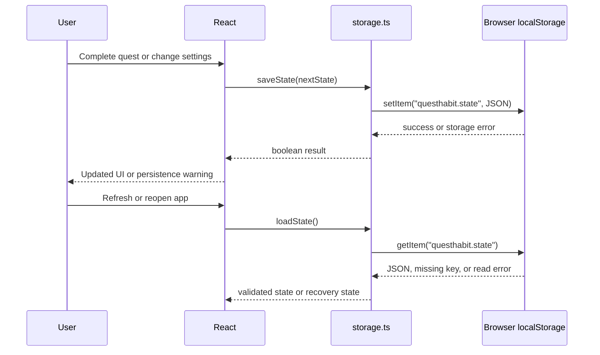

# Local storage and privacy

QuestHabit is local-first by design. There is no account, login, backend, cloud database, or automatic cross-device synchronization.

## What is stored

The app stores one JSON document under:

```text
questhabit.state
```

The document contains:

- Profile information such as display name, avatar, theme, and preferences
- Quest definitions and their schedules
- Completion records, including quest ID, local date, timestamp, and XP earned
- Unlocked achievement IDs

The Settings page can also create a JSON backup file containing the current state.

## Load and save lifecycle

At startup, `src/lib/storage.ts` reads `questhabit.state`. If the key is absent, the app creates a blank state and shows onboarding. If JSON cannot be parsed or required top-level fields are missing, the app starts a fresh state and surfaces a recovery message.

After React state changes, the root component calls `saveState`. The write is synchronous and replaces the JSON document. A failed write returns `false`, and the UI warns that browser storage may be blocked or full. The app does not claim that data was saved when the browser rejected the write.



## Why data persists

Browser storage is associated with the site origin and browser profile. A refresh or later visit to the same deployed Vercel origin can read the same `questhabit.state` document, subject to browser policies and available quota.

The data is not shared automatically between:

- Different browsers
- Different browser profiles
- Different devices
- Private/incognito sessions

Clearing site data, resetting browser storage, or using a browser that blocks storage can remove or prevent access to progress. QuestHabit does not promise guaranteed persistence, encryption, or secure backup.

## Backup and restore

### Versioned backup format

QuestHabit uses a versioned JSON backup format (`version: 1`) to ensure data integrity and forward compatibility:

```json
{
  "version": 1,
  "exportedAt": "2026-10-22T00:00:00.000Z",
  "profile": {
    "name": "Adventurer",
    "avatar": "🧙",
    "theme": "midnight",
    "onboarding": true,
    "target": 3,
    "weekStart": 1,
    "reducedMotion": false
  },
  "quests": [ ... ],
  "completions": [ ... ],
  "unlocked": [ "first", "streak3" ]
}
```

**Export:** Settings serializes the current state along with schema version 1 and an export timestamp into a downloadable `questhabit-backup.json` file.

**Import:** Settings reads the selected file, parses JSON, and performs strict validation and schema migration:

1. **Schema versioning & migration**:
   - Backups containing `version: 1` are validated against schema version 1.
   - Legacy unversioned backups (lacking a `version` property) are automatically recognized and migrated to version 1: missing optional profile fields receive safe defaults from `blankState().profile`, and missing `unlocked` arrays default to `[]`.
   - Backups with invalid versions or unsupported future versions (e.g., higher than current supported version) are rejected with clear user-facing errors.
2. **Strict record validation**:
   - **Profile:** Display name must be a string, avatar must be a non-empty string, theme must match one of the defined themes, `target` must be an integer $\ge 1$, `weekStart` must be 0 or 1, and `onboarding` and `reducedMotion` must be booleans.
   - **Quests:** Each quest must contain valid IDs, non-empty titles, icons, categories, difficulties, non-negative integer XP and duration, valid frequencies and weekday lists, valid local calendar dates (`YYYY-MM-DD`), and `endDate` must not precede `startDate`.
   - **Completions:** Each completion must have a non-empty ID, a valid local calendar date (`YYYY-MM-DD`), valid completion timestamp, and non-negative integer XP. Historical completion XP is preserved and never recalculated during import.
   - **Unlocked achievements:** Each achievement ID is validated against known milestone badge IDs, and duplicates are removed.
3. **Duplicate and reference checks**:
   - Duplicate quest IDs are detected and rejected.
   - Duplicate completion IDs are detected and rejected.
   - Referential integrity is enforced: all completions must reference a quest present in the backup's `quests` list.
4. **Local calendar dates**:
   - Dates remain local calendar date strings (`YYYY-MM-DD`) and are never converted through UTC in a manner that could shift a completion or quest schedule to a different day.
5. **Atomic import**:
   - If JSON parsing, schema migration, record validation, duplicate detection, or referential integrity checks fail, the import operation is rejected completely.
   - The user is notified with the exact error cause, and the existing local state in browser storage is preserved untouched. Existing data is only replaced when validation succeeds and the user explicitly confirms the action.

## Why there is no synchronization

Automatic synchronization would require a server-side identity and data service, which would change QuestHabit's privacy and architecture. The project deliberately keeps user-specific progress in the browser and uses explicit JSON export/import for moving data between browser profiles or devices.
